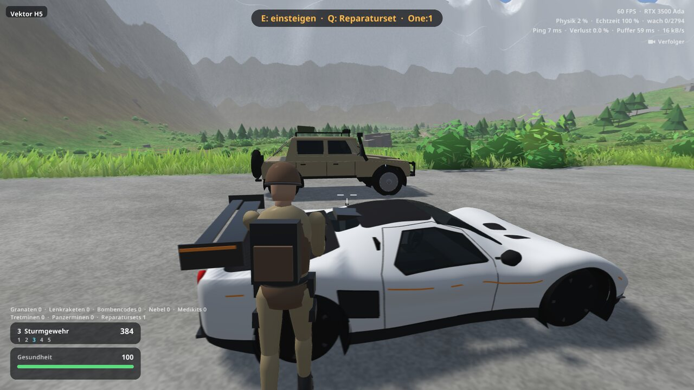

# BeanNG

Online-Panzerduell mit Soft-Body-Physik im Stil von BeamNG, in C++20 mit SDL3 und OpenGL 3.3.


Zwei bis sechs Spieler, eine große Karte, und alles, was sich bewegt oder kaputtgeht, ist ein Soft Body aus Knoten und Balken bei 2000 Physikschritten pro Sekunde. Du startest zu Fuß mit Pistole und Messer und entscheidest selbst, wie du den Gegner erwischst: mit dem Panzer, dem Auto, aus 800 m durchs Zielfernrohr oder per Lenkrakete quer über die Karte.

| | |
|---|---|
|  |  |
|  |  |
|  |  |
|  |  |

## Bauen und starten

    ./run.sh

Auf Laptops mit zwei GPUs nutzt das Spiel automatisch die dedizierte Karte. Mit `BEANNG_GPU=integrated ./run.sh` läuft es auf der integrierten.

Abhängigkeiten: SDL3, libepoxy, CMake, ein C++20-Compiler, Python 3 mit numpy, scipy und shapely.

### Windows

    ./build-windows.sh

Baut unter Linux mit MinGW-w64 alles in eine einzige Datei, `dist/BeanNG.exe`: Spiel, Server und Modelle. Es muss nichts dazu installiert werden, die Datei läuft ab Windows 10. Das Skript braucht `mingw-w64-gcc`, `cmake`, `ninja`, `meson`, `python` und `curl`, und lädt SDL3 und libepoxy beim ersten Mal selbst herunter. Einstellungen landen im Ordner, aus dem das Spiel gestartet wird.

Der Server steckt in derselben Datei: `BeanNG.exe --server 27015`, mit denselben Optionen wie `beanng-server`. `dist/BeanNG-Server.exe` ist er allein, ohne Grafik. Windows- und Linux-Spieler können zusammen spielen. Die Windows-Version kommt ohne AVX aus und läuft damit auch auf älteren Rechnern.

### Release

    ./build-release.sh

Legt die vier Dateien eines Releases in `dist/release/`: Client und Server für Windows und Linux, jede für sich lauffähig. Der Linux-Client trägt SDL3, libepoxy und die Modelle in sich und braucht glibc 2.38 oder neuer.

## Online-Duell

Zwei bis sechs Spieler auf einer eigenen Karte: je eine Basis im Westen und im Osten, dazwischen Dörfer, Hügel, Wälder, ein Fluss mit drei Brücken und zwei hohe Sperrmauern, über die nur die Artillerie schießen kann. Die Physik läuft allein auf dem Server, die Spieler schicken nur ihre Eingaben.

```sh
./run.sh --help                 # baut auch den Server
build/beanng-server 27015       # auf dem Rechner, den alle erreichen können
```

Im Spiel: **Online spielen**, Benutzername, Adresse und Port eintragen, **Verbinden**. Oder direkt mit `./run.sh --connect 1.2.3.4:27015`. Der Port ist UDP und muss von außen erreichbar sein.

**Ablauf:** Sind alle da, wählt jeder seine Ausrüstung (20 Slots, 60 Sekunden): Tretmine 2 Slots, Panzermine 5, Reparaturset 10, Sturmgewehr 2, 60 Schuss Kleinmunition 1, Nebelgranate 1, Ghillie-Anzug 3, Tarnnetz 3. Du startest zu Fuß mit Pistole und Messer in deiner Basis. Eine Seite verliert, wenn von ihr niemand mehr lebt; nach 8 Sekunden geht es von vorn los. Ausrüstung und Beute gelten für ein Match.

**Karte:** 2 km groß, ringsum Berge. Dazwischen Dörfer, Hügel, Wälder, Hecken, Erdwälle, Felsgruppen, alte Panzerwracks, ein Fluss mit drei Brücken, zwei flache Furten und zwei 10 m hohe Sperrmauern, über die nur die Artillerie schießt.


**Brücken sprengen:** Jede Brücke besteht aus vier Feldern zwischen ihren Pfeilern, und jedes kann einstürzen: mit einem guten Artillerietreffer, drei Lenkraketen, zwei Bombenraketen oder sechs Granaten der 105 mm an dieselbe Stelle. Was darauf steht, fällt in den Fluss, und auch die Karte zeigt die Lücke. Dann bleiben die anderen Brücken und die Furten; wer unten im Fluss landet, kommt über die Furten wieder heraus. Im nächsten Match steht alles wieder.

**Fahrzeuge:** In jeder Basis stehen zwölf Panzer, alle vier Türme auf je drei Wannen (mittel, schwer gepanzert und langsamer, schnell und dünn), sowie Xantia Activa, Koenigsegg One:1 und Hummer H1. Einsteigen kannst du in jedes freie Fahrzeug, auch beim Gegner. Reparieren geht nur von außen mit einem Set.


| Turm | Waffe | Besonderheit |
|---|---|---|
| 105-mm-Kanone | 8 Granaten | fünf Volltreffer von vorn bis zur Zerstörung |
| Leichte Kanone | 120 Schuss, schnell | leicht, wenig Schaden pro Schuss |
| Artillerie | 8 Granaten, Steilfeuer auf einen Kartenpunkt | ein Treffer zerstört jeden Panzer und reißt einen großen Krater; schwer und langsam |
| Lenkraketen | 8 Raketen und ein schwaches Geschütz | Rakete wird mit dem Blick über die ganze Karte geflogen |

**Panzerung:** Es zählt, wo und wie eine Granate auftrifft. Von vorn hält ein mittlerer Panzer fünf Volltreffer der 105 mm aus, in die Seite vier, ins Heck drei; der Turm hat seine eigene Front, und das Dach ist dünn. Je schräger der Treffer, desto weniger richtet er an. Trifft eine Kanonengranate flacher als etwa 75° zur Senkrechten auf, prallt sie ab und fliegt weiter; der Schütze sieht dann „Abpraller“. Die Artillerie schert das nicht, Raketen und Minen prallen ebenfalls nicht ab.

**Schaden am Panzer:** Motor, Kanone, Turmkranz, Munition und Ketten nehmen einzeln Schaden. Schwachstellen wie Optik, Entfernungsmesser, Winkelspiegel, Kühler, Treibstoffleitung, Höhenrichtanlage und Antenne erreicht auch das Scharfschützengewehr, und jede nimmt dem Panzer etwas anderes.

**Scharfschützengewehr:** schießt aus jeder Haltung und zieht eine kurze Rauchspur, Zoom 6x bis 24x, Geschossabfall, Wind und Flugzeit. Auf 1000 m sind das gut eine Sekunde und 5,5 m Abfall. Im Auto trifft es, was im Weg liegt: Tank, Ölwanne, Motor, Kühler, Getriebe, Reifen oder den Fahrer.

**Visiere:** In Kisten liegen zwei Visiere fürs Scharfschützengewehr, im Zielfernrohr wird umgeschaltet. Das **Thermalvisier** zeigt die Welt grau und alles Warme weiß: Soldaten, auch im Ghillie-Anzug und im Nebel, und Fahrzeuge, die gerade gefahren wurden. Ein Fahrzeug wird beim Fahren warm und kühlt danach über Minuten ab, auch wenn es mit Fahrer nur herumsteht. Das **Schwachstellenvisier** färbt die Welt grau und die Flächen der Fahrzeuge, auf denen ein Treffer zählt, genau dort ein: rot beendet es, orange legt es lahm, gelb stört nur. Die große dunkle Fläche um den Motor und die rote um die Munition gelten für Granaten, die kleinen hellen darauf auch für Kugeln. Bei Gegnern zu Fuß leuchtet der Kopf, der doppelt zählt. Durch Wände sehen beide nicht; das Schwachstellenvisier prüft die Sichtlinie, das Thermalbild zeigt nur, was ohnehin im Blick ist.

**Finden:** In Häusern und bei Wracks stehen Kisten mit Munition, Scharfschützengewehr, Raketenwerfer, Reparatursets, Minen, Medikits, Nebelgranaten, Ghillie-Anzügen, Tarnnetzen, Drohnen und Bombencodes. Ein Code holt vier ungenaue Raketen auf einen Kartenpunkt, ein Medikit gibt 50 Leben zurück.

**Werkzeug-Overlay:** **Q** (Controller: **RB**) listet alles, was du dabeihast: Minen, Medikit, Reparaturset, Nebel, Tarnnetz, Drohne, Bombencode und die Standortabfrage. Einzelne Tasten dafür gibt es nicht. Was gerade nicht geht, steht mit Grund dabei. Ein Bombencode öffnet die Karte, dort wählst du das Ziel.


**Tarnen und Aufklären:** Nebel versperrt eine halbe Minute lang die Sicht, als Granate oder aus dem Werfer auf dem Turm. Ein Ghillie-Anzug tarnt im Gras und liegend, ein Tarnnetz den stehenden Panzer, bis er losfährt. Eine Drohne fliegst du selbst, ihr Feuerknopf markiert den Gegner.

**Ladebildschirme:** Beim Start mit Fortschritt und Tipps, beim Verbinden, beim Warten auf die Mitspieler und vor einem neuen Match. ESC oder B bricht das Warten ab.

**Vektoren:** Die Karte ist in 8 x 8 Felder geteilt, A bis H von West nach Ost, 1 bis 8 von Nord nach Süd, also A1 bis H8. Oben links im Bild steht immer dein aktuelles Feld, im Chat gibt es dazu die Schnellnachricht „Ich bin in Vektor …“.

**Computer:** Im Kommandozentrum des Gegners lässt sich der Hauptcomputer in 5 Sekunden anzapfen. Danach zeigt die Karte alle 30 Sekunden auf Anfrage für jeden lebenden Gegner mit Namen ungefähr, wo er gerade ist.

**Mehr Spieler:** `beanng-server --players 4` oder `6` macht daraus 2v2 oder 3v3, ein Team pro Basis. Im Panzer gibt es zwei Plätze: Wer zuerst einsteigt, fährt, der zweite ist Richtschütze und führt Turm und Kanone. Eine Seite verliert, wenn von ihr niemand mehr lebt.

**Zuschauen:** Wer im Team fällt, sieht danach einem Mitspieler über die Schulter, der noch lebt. Maus oder rechter Stick drehen die Kamera, Linksklick (Controller: X) wechselt zum nächsten. Dem Gegner schaut niemand zu.

**Helikopter:** Neben jedem der drei Spawnplätze einer Basis steht einer, links und rechts zwischen Kommandozentrum und erster Panzerreihe, auch die des Gegners lassen sich nehmen. Er fliegt dorthin, wohin du schaust. W, A, S und D bewegen ihn, Shift gibt mehr Tempo, Leertaste steigt und Strg sinkt. Wer Strg hält, wird zum Boden hin von selbst langsam und landet. Die Gatling unter der Nase hat 200 Schuss und feuert, solange die Feuertaste gehalten wird; jeder Schuss zieht eine kurze Rauchspur hinter sich her. Mit der Kamerataste (C, Controller: Y) hängt die Kamera in der Einstellung „Haube“ direkt neben der Gatling, in „Fahrer“ im vorderen Cockpit. Die Zustandsanzeige rechts zeigt Rotoren, Motor, Kabine und Munition von oben.

Jeder Panzerschuss in seiner Nähe, jede Rakete und jede schwere Explosion lassen ihn sofort explodieren. Normale Schusswaffen brauchen sechs Treffer auf Motor oder Hauptrotor oder vier auf den Heckrotor, das Scharfschützengewehr zählt dreifach. Dann stürzt er ab und explodiert beim Aufschlag. Treffer ins Cockpit verletzen den Piloten. Am Boden bringt ein Reparaturset beschädigte Teile in 6 Sekunden wieder auf 60 %, solange er nicht schon explodiert ist.

Fahrzeuge, Wracks, Bäume, Häuser und andere Helikopter bringen ihn zum Absturz, auch mit dem Rotor; fährt ein Fahrzeug in einen stehenden Helikopter, explodiert er ebenfalls. Wer in einen laufenden Rotor gerät, stirbt, auch aufrecht darunter am Boden; geduckt kommt man unter ihm durch. Einen Fallschirm gibt es nicht: Wer in der Luft aussteigt, stirbt beim Aufprall, außer aus geringer Höhe.

**Lenkraketen:** Sie reichen 1100 m; danach ist der Motor aus, die Verbindung weg, und sie fallen. Um jede Basis stehen Störsender (240 m, auf der Karte eingezeichnet): Darin bricht das Bild ab und die Rakete fliegt zufällig umher, bis sie die Zone wieder verlässt. Mit Feuer lässt sie sich jederzeit sprengen.

**Haltung:** Strg schaltet das Ducken ein und aus (Controller: Klick auf den rechten Stick): niedriger, schwerer zu treffen und langsamer, Rennen und Springen gehen dabei nicht. X legt dich jederzeit hin und wieder auf (Controller: B), mit jeder Waffe; im Liegen bist du flach und bewegst dich nicht. Geschossen wird aus jeder Haltung, auch mit dem Scharfschützengewehr und durch sein Zielfernrohr.

**Tarnnetz:** Das Tarnnetz lässt sich jetzt auch als Plane über ein stehendes Auto ziehen. Das dauert 3 Sekunden, beim Losfahren bleibt es zurück.

**Kill-Cam:** Wer stirbt, sieht knapp eine Sekunde später die letzten 7 Sekunden noch einmal: aus der Sicht des Gegners, bei einer Lenkrakete aus der Sicht der Rakete, und aus der eigenen, wenn niemand anderes schuld war. Eine beliebige Taste überspringt sie.

**Mitspieler:** Über jedem Mitspieler stehen sein Name in der Farbe des Teams (West blau, Ost orange) und seine Leben, auch durch Wände und über Fahrzeugen. Auf der Karte sind lebende Mitspieler mit Namen in derselben Farbe zu sehen. Namen dürfen keine Leerzeichen enthalten, im Menü lassen sie sich gar nicht erst eintippen. Der Server macht aus einem Leerzeichen sonst einen Unterstrich und hängt bei doppelten Namen eine Zahl an.

**Punktestand:** Solange TAB gehalten wird (Controller: Back gedrückt halten), zeigt eine Tabelle den Stand der Teams und alle Spieler mit ihren Kills und Toden. Kurz auf Back getippt öffnet wie bisher den Chat. Ein Kill zählt für den Gegner, der einen zuletzt getroffen hat, wenn das nicht länger als 30 Sekunden her ist. Wer in seinem Fahrzeug stirbt, zählt für den, der das Fahrzeug zuletzt getroffen hat. Teamkills zählen nicht als Kill, der Tod zählt aber trotzdem. Die Zahlen gelten über alle Matches eines Servers und beginnen neu, wenn jemand Neues einen Platz übernimmt.

**Bots:** `beanng-server --bots 1` lässt dich gegen den Rechner antreten, `--players 4 --bots 3` ergibt zwei gegen zwei mit einem Bot an deiner Seite. Fehlen Plätze, erhöht `--bots` die Spielerzahl von selbst, und auf der Serverkonsole geht es mit `/bot add` und `/bot remove` auch mitten im Spiel. Verbindet sich ein Mensch und alle Plätze sind belegt, übernimmt er den Platz eines Bots, und zwar dort, wo der gerade steht.

Jede Runde entscheidet sich ein Bot für eine andere Taktik als zuletzt und nimmt die passende Ausrüstung mit:

| Taktik | Was der Bot macht |
|---|---|
| Sturm | Nimmt einen Panzer mit 105 mm, sucht den Gegner und greift direkt an |
| Flanke | Fährt im schnellen Panzer in weitem Bogen und schießt von der Seite, wo die Panzerung dünner ist |
| Hinterhalt | Versteckt sich im schweren Panzer an einer Straße oder Brücke, zieht das Tarnnetz über und schießt erst aus der Nähe. Ist er entdeckt, wechselt er den Platz oder greift an |
| Scharfschütze | Sucht in Kisten nach dem Gewehr, legt sich im Ghillie-Anzug auf eine Anhöhe und zielt bei Panzern auf die Ketten |
| Plünderer | Fährt mit wenig Gepäck von Kiste zu Kiste und greift danach mit dem Gefundenen an |
| Spion | Fährt zur gegnerischen Basis, zapft dort zu Fuß den Rechner an und jagt dann mit dessen Standortangaben |
| Lenkrakete | Nimmt den Raketenpanzer und lenkt die Raketen aus großer Entfernung ins Ziel |
| Helikopter | Steigt auf, kreist um den Gegner und schießt mit der Gatling, von Panzern hält er mehr Abstand. Bei Schäden landet er zum Reparieren, ohne Munition steigt er auf einen Panzer um |

Hinterhalt und Scharfschütze warten nur begrenzt, Plünderer und Flanke geben ihren Plan ebenfalls irgendwann auf; danach greifen sie an. Verstecke wählt ein Bot nah an der Straße, weil jeder Meter durchs Gras eine sichtbare Spur hinterlässt. Stößt er selbst auf frische Spuren eines Gegners, folgt er ihnen. Er plündert, wenn ihm etwas fehlt: Medikit, Munition oder Waffen. Fehlen Panzergranaten, fährt er zu den alten Wracks. Nach einem Treffer weicht er aus, nutzt Nebel und repariert. Ist der Panzer nicht mehr zu retten, steigt er aus und holt sich einen anderen.

Bots spielen nach denselben Regeln wie alle anderen, wissen aber etwas mehr: alle 30 Sekunden ungefähr, wo der nächste Gegner ist, damit ein Match nicht ewig dauert; ungefähr, woher ein Treffer kam; und in welche Richtung eine Spur führt. Bäume, Häuser und Nebel versperren ihnen die Sicht, Büsche nicht. Artillerie, Autos, Minen und Drohnen benutzen sie nicht.

**Vegetation:** Wiesen aus Gras in drei Höhen und Büsche, die im Wind wogen. Was darüberfährt, drückt sie platt, eine Explosion brennt sie weg. Beides sind Instanzen mit je einem Drawcall, das Gras wird nur um die Kamera herum erzeugt und dünnt mit der Entfernung weich aus. Die **Grasdichte** lässt sich in den Spiel-Einstellungen wählen.


**Wenn es ruckelt:** Die Leistungsanzeige oben rechts zeigt im Spiel die Werte des Servers: Physiklast, Echtzeit und wache Objekte. Sinkt die Echtzeit unter 100 %, kommt der Server nicht hinterher. `--log` schreibt bei Client und Server einmal pro Sekunde alles Wichtige nach `/tmp/beanng-*.log`.

**Replay:** Nach dem Verlassen eines Matches zeigt das Hauptmenü **Letztes Match ansehen**, aus der Sicht jedes Spielers oder frei fliegend.

**Serverkonsole:** Text ohne `/` geht in den Chat. Dazu `/give <spieler> <sache> [anzahl]`, `/kill <spieler> [täter] [rakete]`, `/kick`, `/bot add|remove`, `/bridge <1-3>`, `/players`, `/restart`, `/wind`, `/help` und `/quit`. TAB ergänzt Befehle, Spieler und Sachen. `--give-all` gibt allen von Anfang an alle Waffen und den angezapften Rechner, zum Ausprobieren. Spieler heißen in allen Befehlen bei ihrem Namen. `/players` zeigt bei Bots die aktuelle Taktik und was sie gerade tun; jeder Taktikwechsel erscheint außerdem nur auf der Konsole.

### Netz

Der Server rechnet die Physik mit 2 kHz und schickt seinen Stand **120-mal pro Sekunde**, die Spieler ihre Eingaben genauso oft.

- **Das Eigene antwortet sofort:** Laufen, Fahren, Turm und Mündungsfeuer werden auf dem eigenen Rechner vorausgerechnet. Was der Server anders sieht, wird weich ausgeglichen, Treffer und Schaden entscheidet nur er.
- **Die anderen laufen flüssig:** Fahrzeuge, Soldaten und Effekte erscheinen auf derselben Zeitachse, nur so spät wie die Leitung es verlangt (etwa 55 ms auf einer guten). Bleibt ein Paket aus, bewegt sich alles kurz weiter. Treffer beurteilt der Server genau zu dem Moment, den der Schütze gesehen hat.
- **Wenig Datenmenge:** Ein Fahrzeug geht als Lage plus den Knoten, die sich bewegt haben. Was weit weg ist, kommt seltener (ab 150 m 60-mal, ab 400 m 30-mal pro Sekunde). Bei zwei Spielern sind das etwa 55 kB/s je Spieler, der Server sendet insgesamt rund 85 kB/s, zu viert rund 270 kB/s.

Ping, Verlust, Puffer und Datenrate stehen oben rechts, wenn die Statistik eingeschaltet ist.

Eine schlechte Leitung lässt sich auf einem Rechner ausprobieren, jeder Wert gilt für eine Richtung:

```
BEANNG_FAKE_LAG=40 BEANNG_FAKE_JITTER=20 BEANNG_FAKE_LOSS=2 ./run.sh --connect 127.0.0.1:27015
```

Mit `--log` schreiben Client und Server jede Sekunde ihre Messwerte nach `/tmp/beanng-*.log`.

## Steuerung

Das ganze Spiel geht mit Tastatur und Maus oder allein mit dem Controller, vom Verbinden bis zum Replay. Die Hinweise auf dem Bildschirm zeigen die Tasten des Geräts, das du zuletzt benutzt hast. Die Tastennamen sind die eines Xbox-Controllers; auf anderen zählt die Position.

| Aktion | Tastatur/Maus | Controller |
|---|---|---|
| Gehen, Panzer fahren, lenken | W A S D | linker Stick |
| Auto: Gas / Bremse, im Stand rückwärts | W / S | RT / LT |
| Rennen | Umschalt | linken Stick drücken |
| Bremse, zu Fuß springen | Leertaste | A |
| Zielen, umsehen, Rakete und Drohne lenken | Maus | rechter Stick |
| Feuer | linke Maustaste, F | RT |
| Anvisieren, auch im Panzer | rechte Maustaste halten | LT halten |
| Einsteigen, aussteigen, nehmen, anzapfen | E | X |
| Waffe wählen | 1 bis 5 | Steuerkreuz links, rechts |
| Werkzeug-Overlay | Q, dann Zahl oder ENTER | RB, dann A |
| Karte | K | LB |
| Karte: Ziel markieren, löschen | Klick, Rechtsklick | rechter Stick und A, X |
| Rakete starten, Feuer sprengt sie | G | B im Panzer |
| Hinlegen, aufstehen | X | B zu Fuß |
| Zielfernrohr, Zoom 6x bis 24x | rechte Maustaste, Mausrad | LT, Steuerkreuz links, rechts |
| Visier auf Entfernung einstellen | Pfeil hoch, runter | Steuerkreuz hoch, runter |
| Zielfernrohr: normal, thermal, Schwachstellen | T | Y |
| Kamera, Abstand | C, Mausrad | Y, Steuerkreuz hoch, runter |
| Chat | Enter | Back kurz tippen: Schnellnachrichten oder Bildschirmtastatur |
| Punktestand zeigen | TAB halten | Back halten |
| Ducken ein, aus | Strg | rechten Stick klicken |
| Helikopter: steigen, sinken | Leertaste, Strg | A, B halten |
| Menü | ESC | Start |
| Im Menü wählen, ändern, bestätigen, zurück | Pfeile, ENTER, ESC | Steuerkreuz oder linker Stick, A, B |
| Im Replay: Sicht wechseln, Tempo | TAB, `[` `]` | X, LB RB |
| Gefallen: Mitspieler wechseln | Linksklick | X |
| Screenshot | F12 | – |

**Texteingabe am Controller:** A auf einem Feld im Online-Menü oder **Eigener Text...** im Chat öffnet die Bildschirmtastatur.


In den Spiel-Einstellungen lassen sich die Empfindlichkeit des Sticks und die Vibration einstellen.

## Aufbau

- `src/duel.*`: ein Match ohne Grafik: Karte, Fahrzeuge, Spieler, Waffen, Minen, Loot, Ragdolls
- `src/bot.*`: Spieler, die der Server selbst spielt: Wege, Sicht und Gefecht
- `src/server.cpp`: der Server mit Konsole; `src/net.*`, `src/duelnet.h`, `src/shape.h`: die Pakete über UDP
- `src/main.cpp`, `src/render.*`, `src/audio.*`: der Spieler-Client: Netz, Eingabe, Kamera, Grafik und Ton
- `src/sim.*`: Node-Beam-Solver mit 2 kHz, elastoplastische Beams, Kollisionen, Schlafzustand
- `src/tank.*`: Panzer, Türme, Module und Schwachstellen; `src/vehicle.*` mit `xantia`, `one1`, `hummer`: die Autos
- `src/props.*`: Häuser, Bäume und anderes Zerstörbare; `src/world.*`: Karte, Gelände, Straßen, Fluss, Mauern
- `src/vegetation.*`: Gras und Büsche, instanziert, mit einer Karte für das, was platt gefahren oder verbrannt ist
- `src/platform.*`, `src/asset.*`: was sich zwischen Linux und Windows unterscheidet, und Modelle aus Datei oder aus der `.exe`
- `src/carmesh.*`: bindet die Modelle an die Physik-Nodes; `tools/gen_*.py` erzeugt sie (`./run.sh` macht das von selbst)
- `src/tests.cpp`: Prüfstand ohne Grafik, auf der alten Teststrecke

## Prüfstand

    ./build/beanng-test                    # alles
    ./build/beanng-test crash skidpad      # einzelne Tests

Einzelne Sondertests: `split`, `torn`, `slow`, `winding`, `armour`, `bridge`, `bots [anzahl] [sekunden] [cut|ford]`. `BEANNG_PROFILE=1 ./run.sh` zeigt die Zeit pro Bild.

Tests: `statics bounce accel brake skidpad crash rough jitter response compliance wheel powertrain rest props perf`

Die Fahrzeugdaten sind angenäherte Werte, keine Herstellerdaten.
