# BeanNG

Online-Panzerduell mit Soft-Body-Physik im Stil von BeamNG, in C++20 mit SDL3 und OpenGL 3.3.

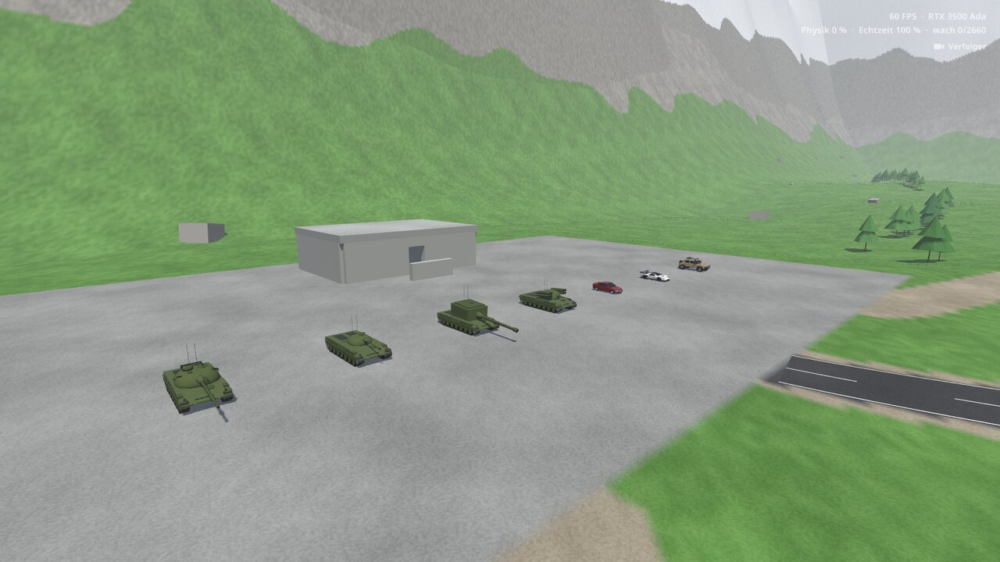

Zwei bis sechs Spieler, eine große Karte, und alles, was sich bewegt oder kaputtgeht, ist ein Soft Body aus Knoten und Balken bei 2000 Physikschritten pro Sekunde. Du startest zu Fuß mit Pistole und Messer und entscheidest selbst, wie du den Gegner erwischst: mit dem Panzer, dem Auto, aus 800 m durchs Zielfernrohr oder per Lenkrakete quer über die Karte.

| | |
|---|---|
| 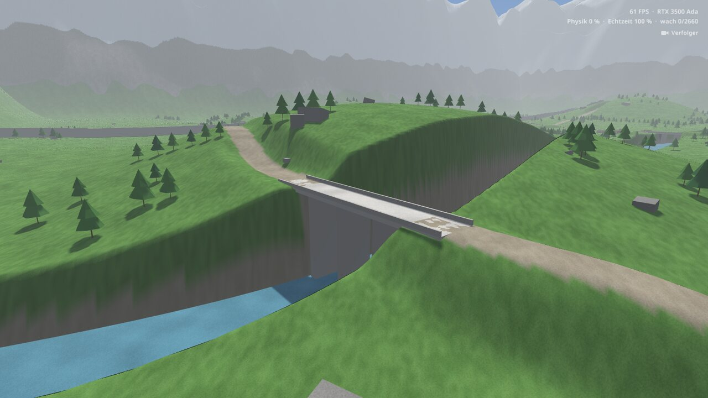 | 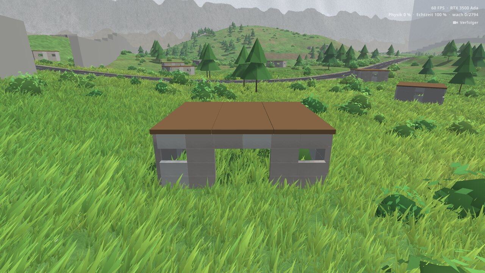 |
| 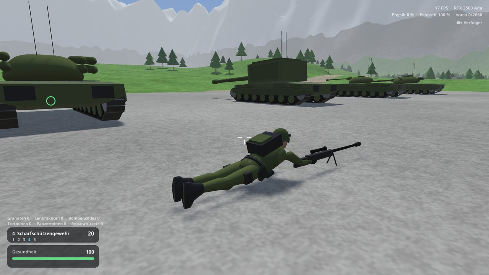 | 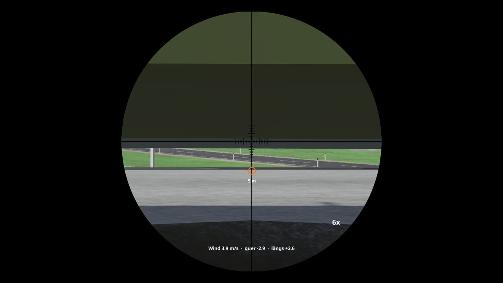 |
| 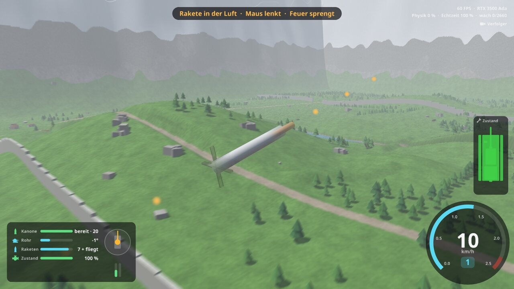 | 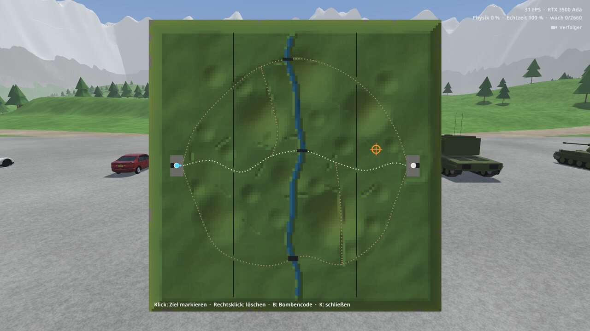 |
| 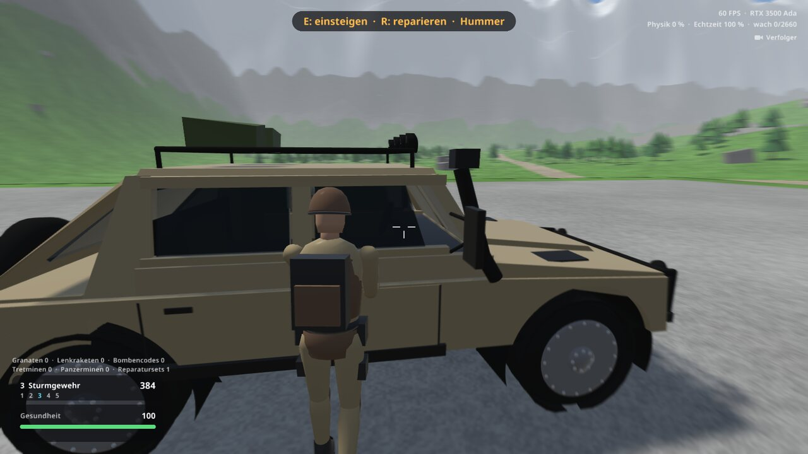 | 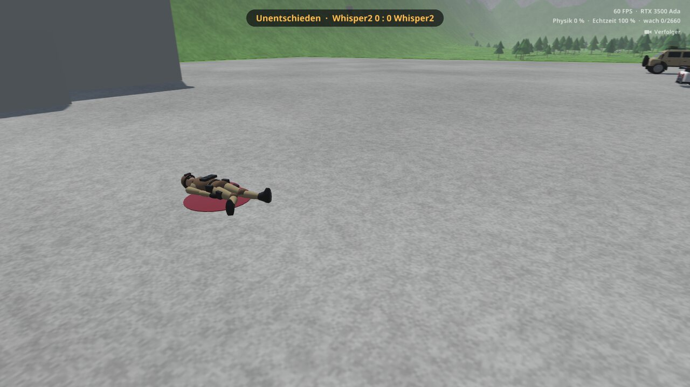 |

## Bauen und starten

    ./run.sh

Auf Laptops mit zwei GPUs nutzt das Spiel automatisch die dedizierte Karte. Mit `BEANNG_GPU=integrated ./run.sh` läuft es auf der integrierten.

Abhängigkeiten: SDL3, libepoxy, CMake, ein C++20-Compiler, Python 3 mit numpy, scipy und shapely.

## Online-Duell

Zwei bis sechs Spieler auf einer eigenen Karte: je eine Basis im Westen und im Osten, dazwischen Dörfer, Hügel, Wälder, ein Fluss mit drei Brücken und zwei hohe Sperrmauern, über die nur die Artillerie schießen kann. Die Physik läuft allein auf dem Server, die Spieler schicken nur ihre Eingaben.

```sh
./run.sh --help                 # baut auch den Server
build/beanng-server 27015       # auf dem Rechner, den alle erreichen können
```

Im Spiel: **Online spielen**, Benutzername, Adresse und Port eintragen, **Verbinden**. Oder direkt mit `./run.sh --connect 1.2.3.4:27015`. Der Port ist UDP und muss von außen erreichbar sein.

**Ablauf:** Sind alle da, wählt jeder seine Ausrüstung (20 Slots, 60 Sekunden): Tretmine 2 Slots, Panzermine 5, Reparaturset 10, Sturmgewehr 2, 60 Schuss Kleinmunition 1, Nebelgranate 1, Ghillie-Anzug 3, Tarnnetz 3. Du startest zu Fuß mit Pistole und Messer in deiner Basis. Eine Seite verliert, wenn von ihr niemand mehr lebt; nach 8 Sekunden geht es von vorn los. Ausrüstung und Beute gelten für ein Match.

**Karte:** 2 km groß, ringsum Berge. Dazwischen Dörfer, Hügel, Wälder, Hecken, Erdwälle, Felsgruppen, alte Panzerwracks, ein Fluss mit drei Brücken zwei flache Furten und zwei 10 m hohe Sperrmauern, über die nur die Artillerie schießt.

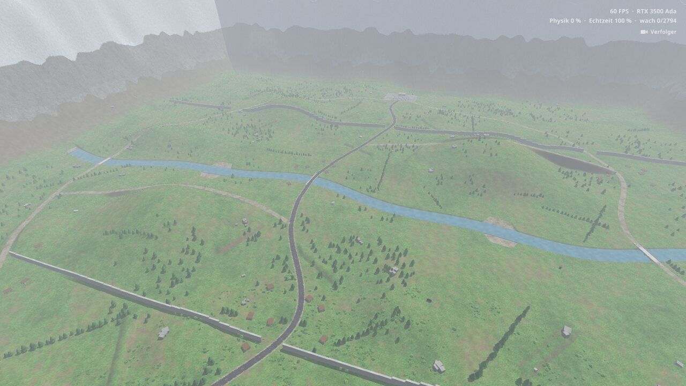

**Fahrzeuge:** In jeder Basis stehen zwölf Panzer, alle vier Türme auf je drei Wannen (mittel, schwer gepanzert und langsamer, schnell und dünn), sowie Xantia Activa, Koenigsegg One:1 und Hummer H1. Einsteigen kannst du in jedes freie Fahrzeug, auch beim Gegner. Reparieren geht nur von außen mit einem Set.

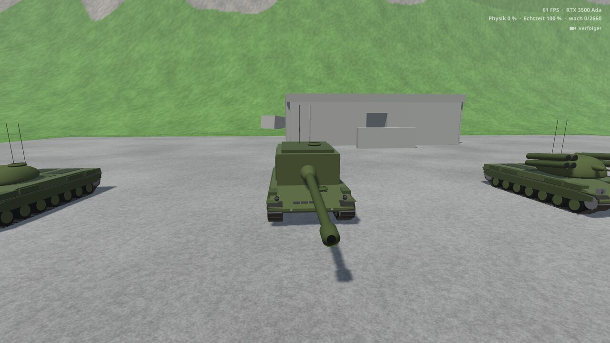

| Turm | Waffe | Besonderheit |
|---|---|---|
| 105-mm-Kanone | 8 Granaten | fünf Volltreffer bis zur Zerstörung |
| Leichte Kanone | 120 Schuss, schnell | leicht, wenig Schaden pro Schuss |
| Artillerie | 8 Granaten, Steilfeuer auf einen Kartenpunkt | ein Treffer zerstört jeden Panzer und reißt einen großen Krater; schwer und langsam |
| Lenkraketen | 8 Raketen und ein schwaches Geschütz | Rakete wird mit dem Blick über die ganze Karte geflogen |

**Schaden am Panzer:** Motor, Kanone, Turmkranz, Munition und Ketten nehmen einzeln Schaden. Schwachstellen wie Optik, Entfernungsmesser, Winkelspiegel, Kühler, Treibstoffleitung, Höhenrichtanlage und Antenne erreicht auch das Scharfschützengewehr, und jede nimmt dem Panzer etwas anderes.

**Scharfschützengewehr:** drei Sekunden Aufbau im Liegen, Zoom 6x bis 24x, Geschossabfall, Wind und Flugzeit. Auf 1000 m sind das gut eine Sekunde und 5,5 m Abfall. Im Auto trifft es, was im Weg liegt: Tank, Ölwanne, Motor, Kühler, Getriebe, Reifen oder den Fahrer.

**Finden:** In Häusern und bei Wracks stehen Kisten mit Munition, Scharfschützengewehr, Raketenwerfer, Reparatursets, Minen, Medikits, Nebelgranaten, Ghillie-Anzügen, Tarnnetzen, Drohnen und Bombencodes. Ein Code holt vier ungenaue Raketen auf einen Kartenpunkt, ein Medikit gibt 50 Leben zurück.

**Werkzeug-Overlay:** **Q** (Controller: **RB**) listet alles, was du dabeihast: Minen, Medikit, Reparaturset, Nebel, Tarnnetz, Drohne, Bombencode und die Standortabfrage. Einzelne Tasten dafür gibt es nicht. Was gerade nicht geht, steht mit Grund dabei. Ein Bombencode öffnet die Karte, dort wählst du das Ziel.

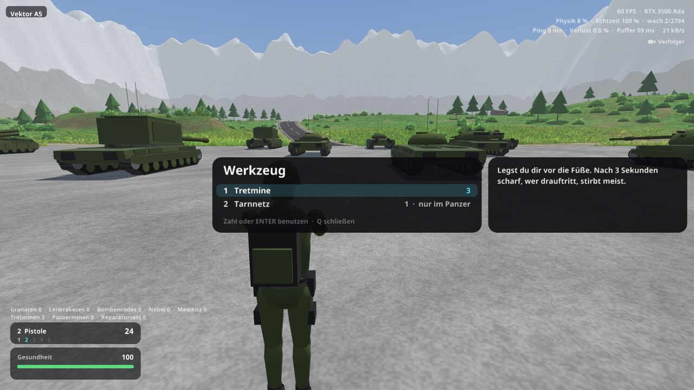

**Tarnen und Aufklären:** Nebel versperrt eine halbe Minute lang die Sicht, als Granate oder aus dem Werfer auf dem Turm. Ein Ghillie-Anzug tarnt im Gras und liegend, ein Tarnnetz den stehenden Panzer, bis er losfährt. Eine Drohne fliegst du selbst, ihr Feuerknopf markiert den Gegner.

**Ladebildschirme:** Beim Start mit Fortschritt und Tipps, beim Verbinden, beim Warten auf die Mitspieler und vor einem neuen Match. ESC oder B bricht das Warten ab.

**Vektoren:** Die Karte ist in 8 x 8 Felder geteilt, A bis H von West nach Ost, 1 bis 8 von Nord nach Süd, also A1 bis H8. Oben links im Bild steht immer dein aktuelles Feld, im Chat gibt es dazu die Schnellnachricht „Ich bin in Vektor …“.

**Computer:** Im Kommandozentrum des Gegners lässt sich der Hauptcomputer in 5 Sekunden anzapfen. Danach zeigt die Karte alle 30 Sekunden auf Anfrage ungefähr, wo er ist.

**Mehr Spieler:** `beanng-server --players 4` oder `6` macht daraus 2v2 oder 3v3, ein Team pro Basis. Im Panzer gibt es zwei Plätze: Wer zuerst einsteigt, fährt, der zweite ist Richtschütze und führt Turm und Kanone. Eine Seite verliert, wenn von ihr niemand mehr lebt.

**Vegetation:** Wiesen aus Gras in drei Höhen und Büsche, die im Wind wogen. Was darüberfährt, drückt sie platt, eine Explosion brennt sie weg. Beides sind Instanzen mit je einem Drawcall, das Gras wird nur um die Kamera herum erzeugt und dünnt mit der Entfernung weich aus. Die **Grasdichte** lässt sich in den Spiel-Einstellungen wählen.

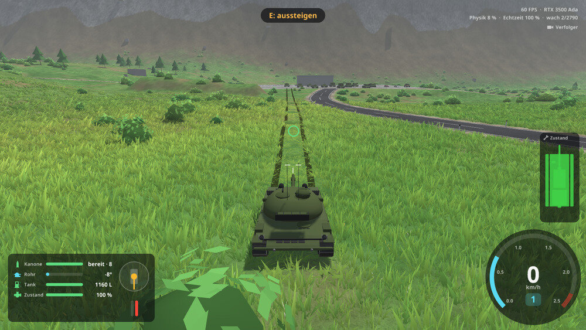

**Wenn es ruckelt:** Die Leistungsanzeige oben rechts zeigt im Spiel die Werte des Servers: Physiklast, Echtzeit und wache Objekte. Sinkt die Echtzeit unter 100 %, kommt der Server nicht hinterher. `--log` schreibt bei Client und Server einmal pro Sekunde alles Wichtige nach `/tmp/beanng-*.log`.

**Replay:** Nach dem Verlassen eines Matches zeigt das Hauptmenü **Letztes Match ansehen**, aus der Sicht jedes Spielers oder frei fliegend.

**Serverkonsole:** Text ohne `/` geht in den Chat. Dazu `/give <spieler> <sache> [anzahl]`, `/kill`, `/kick`, `/players`, `/restart`, `/wind`, `/help` und `/quit`. TAB ergänzt Befehle, Spieler und Sachen. `--give-all` gibt beiden von Anfang an alle Waffen, zum Ausprobieren.

### Netz

Der Server rechnet die Physik mit 2 kHz und schickt seinen Stand **120-mal pro Sekunde**, die Spieler ihre Eingaben genauso oft.

- **Das Eigene antwortet sofort:** Laufen, Fahren, Turm und Mündungsfeuer werden auf dem eigenen Rechner vorausgerechnet. Was der Server anders sieht, wird weich ausgeglichen, Treffer und Schaden entscheidet nur er.
- **Die anderen laufen flüssig:** Fahrzeuge, Soldaten und Effekte erscheinen auf derselben Zeitachse, nur so spät wie die Leitung es verlangt (etwa 55 ms auf einer guten). Bleibt ein Paket aus, bewegt sich alles kurz weiter. Treffer beurteilt der Server genau zu dem Moment, den der Schütze gesehen hat.
- **Wenig Datenmenge:** Ein Fahrzeug geht als Lage plus den Knoten, die sich bewegt haben. Was weit weg ist, kommt seltener (ab 150 m 60-mal, ab 400 m 30-mal pro Sekunde). Bei zwei Spielern sind das etwa 55 kB/s je Spieler, der Server sendet insgesamt rund 85 kB/s, zu viert rund 270 kB/s.

Ping, Verlust, Puffer und Datenrate stehen oben rechts, wenn die Statistik eingeschaltet ist.

Eine schlechte Leitung lässt sich auf einem Rechner ausprobieren, jeder Wert gilt für eine Richtung:

```
BEANNG_FAKE_LAG=40 BEANNG_FAKE_JITTER=20 BEANNG_FAKE_LOSS=2 ./run.sh --connect 127.0.0.1:27015
```

Mit `--log` schreiben Client und Server jede Sekunde ihre Messwerte nach `/tmp/beanng-*.log`.

## Steuerung

Das ganze Spiel geht mit Tastatur und Maus oder allein mit dem Controller, vom Verbinden bis zum Replay. Die Hinweise auf dem Bildschirm zeigen die Tasten des Geräts, das du zuletzt benutzt hast. Die Tastennamen sind die eines Xbox-Controllers; auf anderen zählt die Position.

| Aktion | Tastatur/Maus | Controller |
|---|---|---|
| Gehen, Panzer fahren, lenken | W A S D | linker Stick |
| Auto: Gas / Bremse, im Stand rückwärts | W / S | RT / LT |
| Rennen | Umschalt | linken Stick drücken |
| Bremse, zu Fuß springen | Leertaste | A |
| Zielen, umsehen, Rakete und Drohne lenken | Maus | rechter Stick |
| Feuer | linke Maustaste, F | RT |
| Anvisieren, auch im Panzer | rechte Maustaste halten | LT halten |
| Einsteigen, aussteigen, nehmen, anzapfen | E | X |
| Waffe wählen | 1 bis 5 | Steuerkreuz links, rechts |
| Werkzeug-Overlay | Q, dann Zahl oder ENTER | RB, dann A |
| Karte | K | LB |
| Karte: Ziel markieren, löschen | Klick, Rechtsklick | rechter Stick und A, X |
| Rakete starten, Feuer sprengt sie | G | B im Panzer |
| Scharfschützengewehr aufbauen | X | B zu Fuß |
| Zielfernrohr, Zoom 6x bis 24x | rechte Maustaste, Mausrad | LT, Steuerkreuz links, rechts |
| Visier auf Entfernung einstellen | Pfeil hoch, runter | Steuerkreuz hoch, runter |
| Kamera, Abstand | C, Mausrad | Y, Steuerkreuz hoch, runter |
| Chat | Enter | Back: Schnellnachrichten oder Bildschirmtastatur |
| Menü | ESC | Start |
| Im Menü wählen, ändern, bestätigen, zurück | Pfeile, ENTER, ESC | Steuerkreuz oder linker Stick, A, B |
| Im Replay: Sicht wechseln, Tempo | TAB, `[` `]` | X, LB RB |
| Screenshot | F12 | – |

**Texteingabe am Controller:** A auf einem Feld im Online-Menü oder **Eigener Text...** im Chat öffnet die Bildschirmtastatur.

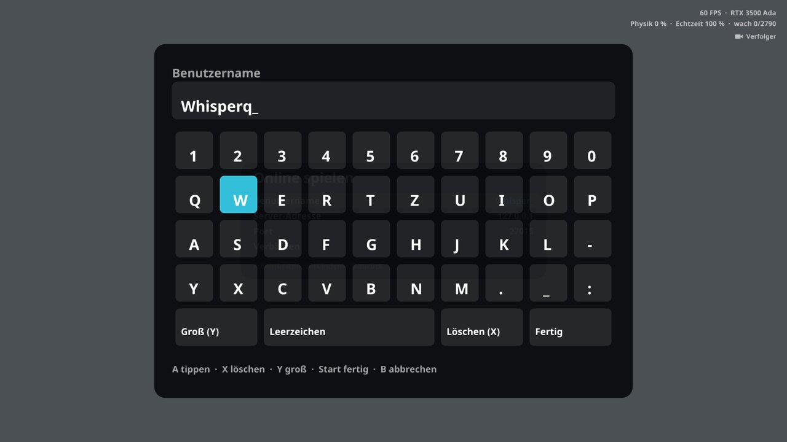

In den Spiel-Einstellungen lassen sich die Empfindlichkeit des Sticks und die Vibration einstellen.

## Aufbau

- `src/duel.*`: ein Match ohne Grafik: Karte, Fahrzeuge, Spieler, Waffen, Minen, Loot, Ragdolls
- `src/server.cpp`: der Server mit Konsole; `src/net.*`, `src/duelnet.h`, `src/shape.h`: die Pakete über UDP
- `src/main.cpp`, `src/render.*`, `src/audio.*`: der Spieler-Client: Netz, Eingabe, Kamera, Grafik und Ton
- `src/sim.*`: Node-Beam-Solver mit 2 kHz, elastoplastische Beams, Kollisionen, Schlafzustand
- `src/tank.*`: Panzer, Türme, Module und Schwachstellen; `src/vehicle.*` mit `xantia`, `one1`, `hummer`: die Autos
- `src/props.*`: Häuser, Bäume und anderes Zerstörbare; `src/world.*`: Karte, Gelände, Straßen, Fluss, Mauern
- `src/vegetation.*`: Gras und Büsche, instanziert, mit einer Karte für das, was platt gefahren oder verbrannt ist
- `src/carmesh.*`: bindet die Modelle an die Physik-Nodes; `tools/gen_*.py` erzeugt sie (`./run.sh` macht das von selbst)
- `src/tests.cpp`: Prüfstand ohne Grafik, auf der alten Teststrecke

## Prüfstand

    ./build/beanng-test                    # alles
    ./build/beanng-test crash skidpad      # einzelne Tests

Einzelne Sondertests: `split`, `torn`, `slow`, `winding`. `BEANNG_PROFILE=1 ./run.sh` zeigt die Zeit pro Bild.

Tests: `statics bounce accel brake skidpad crash rough jitter response compliance wheel powertrain rest props perf`

Die Fahrzeugdaten sind angenäherte Werte, keine Herstellerdaten.
